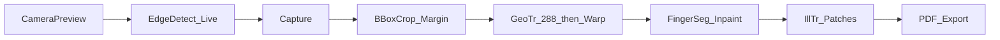

# ARCHITECTURE.md

Scanbooks의 **컴포넌트 간 계약**과 그 계약을 구현하는 **인터페이스 형태**다. 일정은 [ROADMAP.md](ROADMAP.md). 컴포넌트 내부 설계는 해당 폴더의 `DESIGN.md`. 공통 화면·플로우는 [docs/UIUX.md](docs/UIUX.md).

§1은 규칙(왜). §2 이후는 형태(어떻게). 규칙이 바뀌면 §1을 먼저 고친다.

## 1. 계약사항

1. **온디바이스 전처리.** 촬영·곡면 보정·손가락 제거·조명 보정·PDF 생성은 기기에서만 수행한다. 스캔 이미지를 서버로 업로드하지 않는다. 모델 가중치는 앱 번들 또는 온디맨드 다운로드·캐시로만 배포한다(용량 게이트 초과 시 온디맨드가 우선).
2. **네이티브 듀얼 앱.** UI와 카메라 제어는 iOS(Swift)와 Android(Kotlin)로 각각 구현한다. 크로스플랫폼 UI 프레임워크를 두지 않는다. 공유하는 것은 `engine/`이 정의한 모델 아티팩트·파이프라인 계약·스키마·**공유 테스트 벡터(전·후처리 파리티)**뿐이다.
3. **파이프라인 순서는 고정이다.** 페이지 한 장의 처리는 `crop → geo → finger → ill → done` 순이다. 단계를 건너뛰거나 순서를 바꾸지 않는다. 실패 시 해당 페이지는 `failed`이고 재시도는 실패한 단계부터 다시 시작한다. (M1에서 `ill → finger` 대비 품질 비교는 하되, 앱 계약 기본 순서는 본 조항이다.)
4. **라이브 프리뷰는 테두리만.** 카메라 프리뷰 프레임에서는 문서 테두리 검출만 실시간으로 돌린다. GeoTr·FingerSeg·IllTr은 셔터 이후 비동기로 실행한다.
5. **MVP 곡면 엔진은 DocTr이다.** Geometric unwarping은 DocTr `GeoTr`(및 공식 추론의 문서 마스크 `U2NETP`가 geo 단계에 포함될 수 있음), illumination은 `IllTr`이다. **네트워크 입력 해상도**와 **워핑·후속 작업 해상도**를 혼용하지 않는다(§5). DocScanner 등 대체 모델 교체는 M4 이후이며 MVP 밖이다.
6. **추론 런타임은 ONNX Runtime Mobile이다.** iOS·Android가 동일 ONNX 아티팩트를 소비한다. Core ML 재변환은 여지로 남기되 MVP 필수 경로가 아니다. EP(CPU / CoreML / NNAPI 등)별 latency와 CPU fallback 지점을 벤치에 분리 기록한다.
7. **손가락 제거는 geo 좌표계·자연 조명에서 한다.** FingerSeg 마스크는 **GeoTr 워핑 직후** 이미지에서 얻고, 마스크(+그림자 팽창)로 inpaint한 뒤 IllTr을 적용한다. MediaPipe Hands 랜드마크만으로 마스크를 대체하지 않는다. 본문 인쇄 손/얼굴 오탐 방지를 위해 **이미지 외곽과 맞닿은 연결 성분만** 손가락으로 인정한다.
8. **세션·페이지 상태는 로컬만.** `ScanSession`과 `Page`는 기기 로컬 저장소에 둔다. 클라우드 동기화·계정을 MVP에 두지 않는다.
9. **모델·데이터셋 라이선스를 지킨다.** DocTr 계열은 비상업(연구·개인·비영리) 사용이 기본이고 상업 이용은 저자 서면 허가가 필요하다. 앱·문서·릴리스 노트에 attribution을 넣고, 상업 배포 전에 라이선스 상태를 ROADMAP 검토 항목으로 닫는다.
10. **대용량 모델은 소스 트리에 커밋하지 않는다.** `.onnx` 및 양자화 산출물은 Git LFS 또는 GitHub Releases 아티팩트로 배포하고, 메타데이터·체크섬만 저장소에 둔다.
11. **중간 산출물은 무손실이다.** `crop`/`geo`/`finger`/`ill` 사이 디스크 저장은 PNG(또는 동등 무손실) 또는 메모리 버퍼다. JPEG는 최종 표시·공유·PDF 래스터에만 쓴다. 단계 간 JPEG 재압축을 금지한다.
12. **후처리 파리티.** `grid_sample`/`remap`·inpaint 결과는 `engine/`이 발행한 픽스처로 iOS·Android가 동일 허용오차 안에 들어와야 한다. `align_corners=True`에 맞춘 좌표 규약과 border 모드를 `engine/DESIGN.md`에 고정한다.

## 2. 토폴로지와 컴포넌트 경계

```
[사용자]
   │
   ├─ ios/          SwiftUI · AVFoundation · Vision · ORT · OpenCV · PDFKit
   ├─ android/      CameraX · ML Kit/OpenCV · ORT · PdfDocument
   │
   │  공통 계약(스키마·모델 I/O·파이프라인·파리티 픽스처)
   │
   ├─ engine/       PyTorch→ONNX 변환 · 양자화 · CLI 추론 · 골든·파리티 테스트
   └─ models/       아티팩트 메타 · 체크섬 · (LFS/릴리스로 바이너리)
```

| 컴포넌트 | 책임 | 금지 |
|---|---|---|
| `ios/` | 카메라 프리뷰, 테두리 UI, 세션/페이지 로컬 저장, ORT 추론 호출, flow remap·inpaint(OpenCV 등), PDF export | 모델 학습·변환 스크립트 소유 |
| `android/` | 동일(플랫폼 API만 다름) | 동일 |
| `engine/` | DocTr 변환·양자화·벤치·골든/파리티 픽스처, FingerSeg export, 파이프라인 스펙 | 앱 UI, 스토어 배포 |
| `models/` | 배포 아티팩트 식별자·버전·체크섬·라이선스 고지 | 학습 코드 |

앱은 `engine/`이 발행한 모델 버전 문자열과 입출력·전후처리 계약을 그대로 소비한다. 앱이 독자적으로 정규화 상수·flow 좌표 규약·패치 stride를 바꾸지 않는다.

## 3. 처리 파이프라인



| 단계 | `PipelineStage` | 입력 | 출력 | 실행 시점 |
|---|---|---|---|---|
| 테두리 검출 | _(프리뷰 전용)_ | 카메라 프레임 | `Quad` (UI·BBox 산출용) | 실시간 |
| ROI crop | `crop` | `originalUri` + quad 기반 **여유 마진 BBox** | `croppedUri` (작업 해상도로 리사이즈 가능) | 촬영 후 |
| 곡면 보정 | `geo` | `croppedUri` | `dewarpedUri` (워핑본, 아직 ill 전) | 비동기 |
| 손가락 제거 | `finger` | geo 출력 | `cleanedUri` 중간(또는 inpaint 버퍼) → 스키마상 finger 산출 | 비동기 |
| 조명 보정 | `ill` | finger 완료본 | 최종 `cleanedUri` (PDF 소스) | 비동기 |
| 완료 | `done` | — | PDF 포함 가능 | — |
| 실패 | `failed` | — | `errorCode`, `failedStage` | — |

### 3.1 crop 계약

- **기본:** 쿼드 코너의 axis-aligned bounding box에 **마진**(작업 긴 변 대비 비율, `engine`이 상수 확정)을 둔 crop. 엄격한 4점 호모그래피 평면 투영을 기본 경로로 쓰지 않는다.
- **이유:** 휘어진 책 페이지는 코너를 잇는 직선 밖에 곡률이 튀어나오며, 호모그래피 선적용은 내용 절단과 GeoTr 학습 분포 이탈을 만든다.
- **UI:** 프리뷰 쿼드 오버레이는 유지한다. Quad는 BBox·마진 계산 입력이다.
- **M1 검증:** 동일 골든 세트에서 `BBox+margin` vs `Quad homography` 후 GeoTr 품질을 비교하고, 기본 경로는 BBox로 둔다.

### 3.2 단계 의존

`finger`는 `geo` 직후(자연 피부색·그림자 보존). `ill`은 `finger` inpaint 이후(인페인팅 경계 밝기 차이를 IllTr이 완화). M1에서 `ill → finger` 대비 실험은 ROADMAP 매트릭스에 포함하되 앱 기본 계약은 바꾸지 않는다.

## 4. 도메인 스키마

필드명은 양 플랫폼·엔진 로그·테스트 픽스처에서 동일하게 쓴다.

### 4.1 ScanSession

| 필드 | 타입 | 설명 |
|---|---|---|
| `id` | string (UUIDv4) | 세션 PK |
| `createdAt` | ISO-8601 | 생성 시각 |
| `title` | string | 사용자 제목(기본: 날짜) |
| `pageIds` | string[] | 페이지 순서 |
| `exportPdfUri` | string? | 마지막 PDF 경로 |

### 4.2 Page

| 필드 | 타입 | 설명 |
|---|---|---|
| `id` | string (UUIDv4) | 페이지 PK |
| `sessionId` | string | 소속 세션 |
| `index` | int | 세션 내 0-based 순서 |
| `originalUri` | string | 원본 촬영 (JPEG 허용) |
| `croppedUri` | string? | BBox crop본 (PNG) |
| `dewarpedUri` | string? | geo 워핑본 (PNG, ill 전) |
| `cleanedUri` | string? | finger+ill 최종 (PDF 소스; 디스크는 PNG 권장, 공유용 JPEG 파생 가능) |
| `status` | `PipelineStage` | 아래 enum |
| `quad` | `Quad?` | 정규화 좌표 코너(UI·BBox) |
| `metrics` | `PageMetrics?` | 단계별 latency 등 |
| `errorCode` | string? | `failed`일 때만 |

`PipelineStage` = `crop` \| `geo` \| `finger` \| `ill` \| `done` \| `failed`

### 4.3 Quad

정규화 좌표 `[0,1]` 기준, 이미지 좌상단 원점.

```json
{
  "tl": {"x": 0.0, "y": 0.0},
  "tr": {"x": 1.0, "y": 0.0},
  "br": {"x": 1.0, "y": 1.0},
  "bl": {"x": 0.0, "y": 1.0}
}
```

### 4.4 PageMetrics

| 필드 | 타입 | 단위 |
|---|---|---|
| `cropMs` | int | ms |
| `geoMs` | int | ms (네트워크+upsample+remap 포함) |
| `fingerMs` | int | ms |
| `illMs` | int | ms (전 패치·스티칭 포함) |
| `workLongEdge` | int | px (워핑·후속 작업 긴 변, 기본 1024) |
| `geoNetSize` | int | px (GeoTr 정사각 입력, 기본 288) |
| `illPatchSize` | int | px (IllTr 패치, 기본 128) |
| `modelVersion` | string | 예: `doctr-geotr-fp16-v1` |
| `ortEp` | string? | 예: `CPU`, `CoreML`, `NNAPI` |

## 5. 모델 입출력 계약

`engine/`이 버전 태그와 함께 발행한다. 숫자 근거: 공식 DocTr `inference.py` / `inference_ill.py` 및 논문(GeoTr downsample 288×288, IllTr 128×128 patch · overlap 12.5%).

### 5.0 해상도 용어 (혼용 금지)

| 용어 | 의미 | MVP 기본값 |
|---|---|---|
| `geoNetSize` | GeoTr(및 seg) **네트워크**에 넣는 정사각 해상도 | **288×288** |
| `workLongEdge` | flow를 upsample한 뒤 `croppedUri`를 워핑하고 finger/ill이 다루는 **작업 이미지** 긴 변 | **1024** |
| `illPatchSize` | IllTr **패치** 한 변 | **128** |
| `illOverlap` | 패치 오버랩 비율 | **12.5%** (`ovlp = 16` px @ 128) |

GeoTr에 `workLongEdge` 크기 텐서를 넣지 않는다. Transformer 토큰 수·위치 임베딩·학습 스케일이 288 기준이다.

### 5.1 GeoTr (geo 단계)

| 항목 | 계약 |
|---|---|
| 아티팩트 | `geotr.onnx` (+ 공식 경로 사용 시 `seg.onnx`/`u2netp`). 번들 구성을 `models/` 메타에 명시 |
| 네트워크 입력 | RGB, DocTr 추론과 동일 스케일(`/255` 등). **288×288**으로 resize |
| 네트워크 출력 | 288×288×2 backward mapping (DocTr 스케일 변환 `(2*(bm/286.8)-1)*0.99` 포함 여부를 export 그래프에 고정) |
| 워핑 | flow를 **원본 crop 해상도(또는 workLongEdge로 맞춘 크기)** 로 bilinear upsample → blur(공식 3×3) → 샘플링 |
| 샘플링 규약 | PyTorch `grid_sample(..., align_corners=True)`와 동일 좌표. 모바일은 OpenCV `remap` 등 동등 구현 + 파리티 픽스처 검증 |
| 후처리 결과 | `dewarpedUri` |

### 5.2 FingerSeg (finger 단계)

| 항목 | 계약 |
|---|---|
| 아티팩트 | `fingerseg.onnx` |
| 입력 | **geo 출력** (`dewarpedUri`), 자연 조명·피부색 유지 상태 |
| 출력 | 단일 채널 마스크 또는 logits |
| 후처리 | 임계값 → **외곽 접경 connected-component 필터** → 모폴로지(팽창 반경 = `workLongEdge` 비율) → Telea/NS inpaint |
| 금지 | 본문 내부만 떠 있는 성분(인쇄된 손·얼굴)을 손가락으로 채택 |

### 5.3 IllTr (ill 단계)

| 항목 | 계약 |
|---|---|
| 아티팩트 | `illtr.onnx` (입력 **128×128×3** 패치) |
| 입력 이미지 | finger inpaint 완료본 |
| 추론 | 공식과 같이 패치 분할(overlap 12.5%)·스티칭. **ORT에서는 패치 배치(batch>1) 1회 호출**을 M1에서 우선 검증 |
| 출력 | 조명 보정본 → 최종 `cleanedUri` |
| 게이트 미달 시 | stride/overlap 조정 아티팩트 평가 → IllTr 옵션화 또는 경량 full-image 조명 보정으로의 대체(ROADMAP). DocTr GeoTr은 유지 |

### 5.4 성능·용량 게이트 (중급기)

| 항목 | 기준 | 측정 조건 |
|---|---|---|
| GeoTr end-to-end | ≤ 2.5 s / page | net 288 + upsample + remap @ `workLongEdge=1024` |
| IllTr end-to-end | ≤ 3.5 s / page | 전 패치(+배치) + stitch @ work 해상도 |
| FingerSeg+inpaint | 벤치 기록(초기 하드 캡 없음, 합산 UX 목표에 반영) | 동일 work 해상도 |
| 온디바이스 상주 합 | ≤ ~80 MB 권고 | FP16 합; **초과 시 온디맨드 다운로드/캐시를 M1에서 앞당김** |

**양자화:** GeoTr/IllTr에 활성화까지 깎는 static INT8을 기본으로 쓰지 않는다. flow regression·Transformer는 **weight-only INT8 / dynamic quantization / attention·flow head 제외 mixed precision**만 후보로 한다.

**EP 벤치:** `benches/latency.md`에 최소 `CPU×FP32`, `CPU×weight-INT8`, `CoreML|NNAPI×FP16`을 분리 기록하고, GridSample·LayerNorm·동적 Reshape 등으로 인한 **CPU fallback·Cast 삽입** 여부를 프로파일한다. FP16이 CPU EP에서 FP32보다 느리면 해당 EP 조합을 기본 경로로 채택하지 않는다.

**미달 완화(DocTr 유지):** `workLongEdge` 768 → IllTr 옵션화 → IllTr 경량 대체. GeoTr 네트워크 입력을 1024로 키우지 않는다.

## 6. 저장·내보내기

- 이미지 URI는 앱 샌드박스 내 세션 디렉터리 상대 경로로 관리한다.
- 단계 산출물: `cropped.png`, `dewarped.png`, finger/ill 중간·최종 PNG. `original`만 JPEG 허용.
- PDF는 최종 `cleanedUri`가 있는 페이지만 순서대로 넣는다.
- 원본·중간 삭제는 사용자 명시 삭제 또는 설정에서만 한다.

## 7. 라이선스·attribution

| 구성요소 | 출처 | MVP 취급 |
|---|---|---|
| DocTr (GeoTr/IllTr/seg) | [fh2019ustc/DocTr](https://github.com/fh2019ustc/DocTr) | 비상업 연구/개인 빌드 허용을 전제로 통합. 상업 배포 전 저자 서면 허가. About에 논문·리포 크레딧 |
| DocTr-Plus LICENSE | [LICENSE.md](https://github.com/fh2019ustc/DocTr-Plus/blob/master/LICENSE.md) | Non-Commercial / Commercial 구분 참고 |
| ONNX Runtime | Microsoft 라이선스 | 런타임 고지 |
| OpenCV | Apache/OpenCV | remap·inpaint 고지 |
| OSS Document Scanner | NativeScript, MIT | **포크하지 않음.** UX 참고만 |

라이선스 미결 상태로 스토어 상업 배포하지 않는다.

## 8. 테스트·품질 게이트 (컴포넌트 간)

- `engine/` 골든·파리티 테스트가 통과한 모델 버전만 앱이 번들/다운로드한다.
- **골든 기준:** 바이트 해시 금지. `max abs diff` / SSIM(+ 소규모 책 샘플 OCR CER)로 한정.
- **파리티 픽스처:** 전처리 텐서뿐 아니라 `raw_flow → warped`, `raw_mask → inpainted` 기준 PNG/바이너리를 `engine/tests/fixtures/`에 두고 ios/android가 M2/M3에서 동일 검증.
- 골든 세트 구성(최소): 곡률 큰 책 페이지, 엄지 가림, **책 속 인물·손 사진** 포함 페이지.
- 앱 통합 테스트는 stub으로 상태 전이를 검증하고, 실모델은 `engine/` 벤치·기기 스모크에 둔다.
