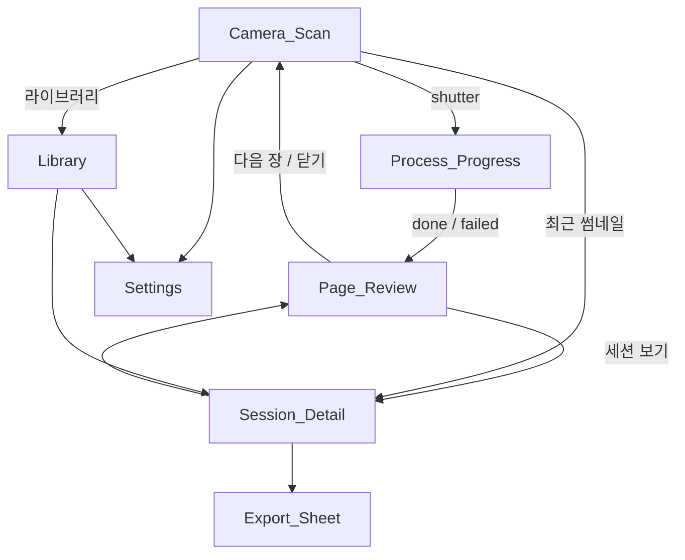
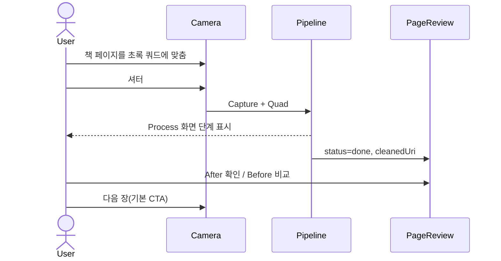

# docs/UIUX.md

Scanbooks **공통 UI/UX 설계**(화면·플로우·카피·피드백). iOS/Android가 같은 IA와 인터랙션을 따르고, 플랫폼 위젯만 네이티브로 구현한다.

컴포넌트 *간* 파이프라인·스키마 계약은 [ARCHITECTURE.md](../ARCHITECTURE.md). 플랫폼 내부 모듈 배치는 [ios/DESIGN.md](../ios/DESIGN.md)·[android/DESIGN.md](../android/DESIGN.md). 일정은 [ROADMAP.md](../ROADMAP.md).

참고 제품: [vFlat Scan](https://vflat.com/ko) (VoyagerX). **복제 금지** — 공개된 UX 패턴만 차용하고, Scanbooks 온디바이스·비동기 보정 제약에 맞게 재설계한다.

## 1. 설계 원칙

1. **앱 열면 곧 카메라.** 온보딩·폴더 목록을 먼저 강제하지 않는다. 첫 화면은 스캔 프리뷰다(vFlat과 동일).
2. **손으로는 책만, 보정은 앱이.** 테두리 정렬·곡면·조명·손가락은 자동. 사용자는 구도·셔터·결과 확인만 한다.
3. **라이브는 테두리만.** vFlat은 프리뷰에서 펴진 결과를 보여 주기도 하나, Scanbooks는 [ARCHITECTURE §1.4](../ARCHITECTURE.md)에 따라 프리뷰에 Dewarp를 돌리지 않는다. 대신 촬영 직후 **단계형 진행 UI**로 “지금 무엇을 하는 중인지”를 명시한다.
4. **연속 스캔이 기본 리듬.** 한 장 찍고 라이브러리로 튕기지 않는다. 결과 썸네일 → 즉시 다음 장 촬영으로 돌아온다.
5. **결과 화면은 Before/After가 핵심.** 원본(곡면·손가락)과 최종본을 한 탭으로 비교할 수 있게 한다.
6. **내보내기는 세션 단위.** PDF는 `ScanSession`의 완료 페이지 순서. OCR·클라우드·계정은 MVP 밖.
7. **온디바이스 신뢰 카피.** “이미지가 서버로 나가지 않음”을 설정·첫 스캔 툴팁에 짧게 고지한다.

## 2. 정보 구조 (IA)

| 화면 ID | 이름 | 역할 | 마일스톤 |
|---|---|---|---|
| `Camera` | 스캔 | 프리뷰·모드·셔터·최근 썸네일 | M2 |
| `Process` | 보정 중 | `crop→geo→finger→ill` 진행 | M3 |
| `PageReview` | 페이지 검토 | Before/After, 재시도, 삭제 | M3 |
| `Session` | 세션(책) | 페이지 그리드·재정렬·PDF | M2 stub / M4 배치 |
| `Library` | 라이브러리 | 세션 목록·폴더(간단) | M4 |
| `Export` | 내보내기 | PDF(필수), 이미지 공유 | M2+ |
| `Settings` | 설정 | 손가락/색보정 토글, 타이머, 고지 | M3 |

## 3. 핵심 사용자 플로우

### 3.1 단장 스캔 (MVP 기본)

### 3.2 배치 스캔 (M4)

1. `Camera`에서 연속 셔터(또는 타이머).
2. 각 장은 백그라운드 큐에 쌓이고, 프리뷰 코너에 **처리 중 N장** 배지.
3. 실패한 장만 `Session`에서 재시도.

### 3.3 PDF 내보내기

1. `Session` → `PDF로 내보내기`.
2. `cleanedUri` 없는 페이지는 목록에 경고 표시 후 제외하거나 export 차단(선택 UI: “완료된 N장만”).
3. 시스템 공유 시트로 전달.

## 4. 화면 상세

### 4.1 Camera (스캔)

**레이아웃 (세로 기준)**

| 영역 | 내용 |
|---|---|
| 상단 좌 | 스캔 모드: `1페이지` \| `2페이지`(M4) \| `자동`(M4+) |
| 상단 우 | 플래시 · 타이머 · 설정(⋯) |
| 중앙 | 풀블리드 카메라 프리뷰 + **초록 쿼드 오버레이** |
| 하단 좌 | 보정 칩: `손가락 지우기` ON/OFF, (선택) 색/조명 강화는 IllTr 고정이므로 MVP에 별도 토글 없음 — Settings로 |
| 하단 중 | 셔터(원형, 큰 터치 타깃 ≥ 72pt) |
| 하단 우 | **최근 페이지 썸네일** → `Session` 또는 `PageReview` |

**프리뷰 피드백**

- 문서 미검출: 얇은 회색 가이드 + 카피 `문서를 화면에 맞춰 주세요`
- 검출 안정: 쿼드가 초록, 짧은 햅틱(선택)
- 수평 힌트(2페이지/책 모드, M4): 중앙 수평 인디케이터 — vFlat의 “원 안에 점” 패턴 차용
- Dewarp 미리보기 **없음**. 오해를 막기 위해 첫 실행 1회 툴팁: `촬영 후 곡면을 펴고 손가락을 지웁니다`

**모드 (vFlat 대응)**

| 모드 | vFlat | Scanbooks MVP |
|---|---|---|
| 1페이지 | 기본 무제한 | **M2 필수** |
| 2페이지 분할 | 스프레드→2장 | M4 (엔진 분할 규칙 별도 확정) |
| 자동 인식/자동 셔터 | 프리미엄 계열 | M4 (안정 쿼드 N프레임 후 자동 캡처) |

### 4.2 Process (보정 중)

전체 화면 모달(또는 Camera 위 시트). 사용자가 파이프라인을 기다리며 “멈춤”으로 느끼지 않게 한다.

| UI 요소 | 규칙 |
|---|---|
| 썸네일 | `originalUri` 또는 crop 중간본 |
| 단계 리스트 | `자르기` → `곡면 펴기` → `손가락 지우기` → `조명 보정` |
| 현재 단계 | 강조 + 스피너. `PipelineStage`와 1:1 매핑(영문 enum, 한글 라벨) |
| 예상 시간 | 중급기 게이트 합(대략 수 초~십수 초) — “보통 10초 안팎” 정적 카피 허용 |
| 취소 | 현재 페이지만 `failed`/`취소됨`, 세션은 유지 |
| 백그라운드 | 홈으로 나가도 작업 유지(플랫폼 백그라운드 제약 내). 불가 시 명시: `앱을 열어 둔 채 기다려 주세요` |

라벨 매핑:

| `PipelineStage` | 한글 라벨 |
|---|---|
| `crop` | 자르기 |
| `geo` | 곡면 펴기 |
| `finger` | 손가락 지우기 |
| `ill` | 조명 보정 |
| `done` | 완료 |
| `failed` | 실패 |

### 4.3 PageReview (페이지 검토)

- 기본 탭: **After** (`cleanedUri`)
- 토글/길게 누르기: **Before** (`originalUri` 또는 `croppedUri`) — vFlat식 “보정 체감”의 대체재
- 액션: `다음 장 촬영`(primary) · `다시 보정` · `삭제` · `세션에서 보기`
- 실패 시: 에러 한 줄 + `이 단계부터 재시도` (`failedStage`)

### 4.4 Session (세션/책)

- 헤더: 제목(인라인 편집) · 페이지 수 · `PDF로 내보내기`
- 본문: 페이지 썸네일 그리드. 배지: 처리중 / 실패 / 완료
- M4: 드래그 재정렬, 선택 삭제, 연속 추가 스캔 CTA

### 4.5 Library

- 세션 카드 리스트(커버=첫 완료 페이지, 제목, 날짜, 장수)
- FAB 또는 탭: `새 스캔` → `Camera`
- 간단 폴더(M4): 기본 폴더 + 사용자 폴더. vFlat 라이브러리 패턴 차용, 계정 동기화 없음

### 4.6 Export

- 기본: **PDF** (완료 페이지만)
- 보조: 이미지 공유(현재 페이지 또는 선택 페이지)
- MVP 비범위: OCR 텍스트, Word, ZIP, PC로 보내기 — 메뉴에 비활성+`준비 중`을 두지 말고 **아예 노출하지 않음**

### 4.7 Settings

| 항목 | 기본 | 비고 |
|---|---|---|
| 손가락 지우기 | ON | OFF 시 `finger` 단계 스킵하지 않고 마스크 적용만 생략 → 파이프라인은 `ill` 후 `done`으로 단축할지 ARCHITECTURE 변경이 필요. **MVP: 토글 OFF면 finger 단계 스킵을 허용하려면 §1.3 예외를 ROADMAP에서 합의 후 ARCHITECTURE 수정.** 합의 전 UI는 ON 고정+설명만 |
| 타이머 | OFF / 3s / 5s | 양손 책 고정용(vFlat 타이머 패턴) |
| 셔터음 | 플랫폼 기본 | |
| 플래시 | 자동/켜기/끄기 | |
| 개인정보 | — | 온디바이스 처리 고지, DocTr attribution 링크 |
| About | — | 모델 버전 문자열 |

## 5. 시각·모션 가이드

유틸리티 스캔 앱이므로 랜딩형 히어로 규칙을 강제하지 않는다. 다만 아래를 지킨다.

- **Camera 크롬:** 어두운 반투명 오버레이 + 고대비 셔터. 프리뷰를 가리는 카드·통계 스트립 금지.
- **쿼드:** 단일 폴리곤, 코너 핸들은 수동 보정 진입 시에만(M3+ 옵션). 기본은 자동 쿼드.
- **강조색:** 검출/성공 = 초록 계열 한 가지. 보라 그라데이션·글로우·알약 칩 남발 금지.
- **모션:** (1) 셔터 시 프리뷰 짧은 디졸브 → Process (2) 단계 체크 순차 등장 (3) PageReview에서 After 페이드인. 장식용 패럴랙스 없음.
- **타이포:** 시스템 UI 폰트(San Francisco / Roboto). 스캔 결과 위 워터마크 텍스트 없음.

## 6. 카피 톤

- 짧고 지시적: `곡면 펴는 중`, `손가락 지우는 중`
- 성공: `펴진 페이지가 준비됐어요`
- 실패: `곡면 보정에 실패했어요. 다시 시도할까요?` + 단계명
- 손가락 팁(설정/툴팁): `책을 누를 때 손가락이 페이지 안에 들어와도 됩니다. 결과에서 지웁니다.` (vFlat 안내와 동일한 사용자 기대)

## 7. 접근성·권한

- 카메라 권한 거부 시: 설정 이동 CTA만, 빈 프리뷰 루프 금지
- 셔터·모드 전환 VoiceOver/TalkBack 라벨
- 진행 단계는 접근성 알림으로 단계 변경을 읽음(과도한 알림 방지: 단계 진입 시에만)
- 최소 대비: 오버레이 아이콘 AA

## 8. vFlat 대비 Scanbooks 차이 (구현 시 혼동 방지)

| 항목 | vFlat | Scanbooks |
|---|---|---|
| 프리뷰 | 보정 결과 미리보기가 강조되기도 함 | **테두리만** 실시간 |
| 보정 체감 | 촬영 직후 즉시 평평한 결과 | Process 단계 UI + Before/After |
| OCR | 핵심 부가 기능 | MVP 비범위 |
| 2페이지/자동 | 제품 핵심 | M4 |
| 계정·프리미엄 페이월 | 있음 | MVP 없음(비상업·로컬) |
| 처리 위치 | 온디바이스 보정 강조 | 동일(서버 업로드 없음) |

## 9. 마일스톤 매핑

| 마일스톤 | UI 범위 |
|---|---|
| M2 | `Camera`(1페이지) · stub `Process` · 간단 `Session` · PDF |
| M3 | 실파이프라인 `Process` · `PageReview` Before/After · Settings 고지 |
| M4 | `Library` 폴더 · 배치/타이머/자동 · 2페이지 · 재정렬 |

## 10. 미결정 (구현 전 닫을 것)

1. **손가락 지우기 OFF** 시 파이프라인 단축을 ARCHITECTURE §1.3 예외로 둘지.
2. **2페이지 분할**을 촬영 시 쿼드 둘로 나눌지, 단일 스프레드 촬영 후 엔진 분할할지.
3. Process를 전체 화면으로 할지, Camera 하단 시트로 할지(연속 스캔 속도 vs 단계 가시성). 기본안: **첫 장은 전체 화면, 배치 모드(M4)는 코너 배지+시트**.
